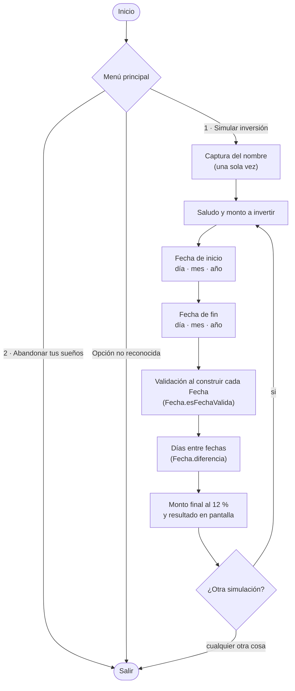

<div align="center">

<br/>

# Banco Kala

### Simulador de Inversiones

*Simula el rendimiento de una inversión a 12 % entre dos fechas, con validación de fechas reales y calendario gregoriano.*

<br/>

<p>
  
  
  
  
  
</p>

[**Inicio rápido**](#inicio-rápido) &nbsp;·&nbsp;
[**Demo**](#demo) &nbsp;·&nbsp;
[**Cómo funciona**](#cómo-funciona) &nbsp;·&nbsp;
[**Arquitectura**](#arquitectura) &nbsp;·&nbsp;
[**Información académica**](#información-académica)

<br/>

</div>

---

## Sobre el proyecto

**Banco Kala** es un simulador de inversiones escrito en Java. El usuario ingresa su nombre, un monto y dos fechas (inicio y fin), escribiendo el mes por su nombre. El programa valida que las fechas existan, calcula cuántos días dura la inversión y en cuánto se convierte el dinero con un rendimiento del **12 %**.

El proyecto está construido con **orientación a objetos**, **encapsulamiento** y **modularidad**: una clase `Fecha` que modela, valida y opera con fechas, y una clase `TiempoDeInversion` que se encarga de la interacción con el usuario y de la simulación.

<br/>

| 📅 **Fechas validadas** | 🗓️ **Calendario gregoriano** | 📈 **Inversión al 12 %** | 💻 **Interfaz en terminal** |
|:---:|:---:|:---:|:---:|
| Una fecha inexistente nunca llega a construirse | Años bisiestos y días de cada mes bien resueltos | Interés simple sobre una base de 365 días | Menú interactivo con opción de repetir la simulación |

<br/>

## Inicio rápido

> [!IMPORTANT]
> Ejecuta los comandos desde la **raíz del repositorio** y verifica que tienes Java 16 o superior con `java -version`.

**1. Compilar**

```bash
javac -encoding UTF-8 -d out DPeña/practica02/src/icc/Fecha.java DPeña/practica02/src/icc/TiempoDeInversion.java
```

**2. Ejecutar**

```bash
java -cp out icc.TiempoDeInversion
```

<details>
<summary><b>Requisitos</b></summary>

<br/>

| Requisito | Detalle |
|:---|:---|
| Java | JDK 16 o superior |
| Terminal | Cualquier consola de comandos |
| Sistema operativo | Cualquiera compatible con Java |

</details>

<details>
<summary><b>Generar la documentación Javadoc</b></summary>

<br/>

```bash
javadoc -d docs -encoding UTF-8 -docencoding UTF-8 -charset UTF-8 DPeña/practica02/src/icc/Fecha.java DPeña/practica02/src/icc/TiempoDeInversion.java
```

Abre `docs/index.html` en el navegador para ver la documentación.

</details>

<details>
<summary><b>Solución de problemas</b></summary>

<br/>

- **`javac` no se reconoce como comando:** instala un JDK (no solo el JRE) y comprueba con `javac -version`.
- **Acentos o caracteres extraños en Windows:** ejecuta `chcp 65001` en la terminal antes de correr el programa.
- **No encuentra los archivos:** confirma que estás parado en la raíz del repositorio, donde vive la carpeta `DPeña/`.

</details>

<br/>

## Demo

Ejecución completa del simulador (lo que escribe el usuario va en su propia línea después de cada pregunta):

```text
Bienvenido al simulador de inversiones de Banco Kala
Por favor, escoge alguna de las opciones disponibles:
1. Simular inversión
2. Abandonar tus sueños.
1
Perfecto, has escogido la opción 1. Vamos a perseguir ese sueño.
Por favor, ingresa tu nombre completo para poder iniciar la simulación de inversión.
Diego Alejandro Peña
Excelente, mucho gusto, Diego Alejandro Peña.
Ahora, por favor, ingresa el monto que desearías invertir. Dame una cifra mayor a cero, sin comas ni puntos, sin símbolos de pesos ni centavos, y sin espacios.
85000
Perfecto, has ingresado el monto de $85000.0.
Requiero un poco más de información para poder acercarnos un paso más hacia tus sueños. Te solicitaré la fecha exacta para iniciar tu camino hacia el éxito.
Por favor, ingresa el día de inicio de tu inversión en el formato dd
12
Por favor, ingresa el mes de inicio en el formato mes (ejemplo; enero, febrero, marzo, etc.)
marzo
Por favor ingresa el año del inicio de tu inversión. Estamos casi listos. No olvides escribirlo con cuatro dígitos, en el formato aaaa, por ejemplo: 2026
2026
Perfecto, mi estimado Diego Alejandro Peña. Has ingresado la fecha de inicio de tu inversión como: 12/Marzo/2026.
Ahora, para calcular el rendimiento de tu inversión a 12%, necesito que me proporciones la fecha de fin de tu inversión, empezaremos por el día.
30
Perfecto ahora necesito que ingreses el mes de finalización de tu inversión, de la misma forma en la que la has ingresado en la fecha de inicio, es decir en formato mes, (minúsculas), de la siguiente forma: enero, febrero, marzo... etc.
septiembre
Para finalizar y calcular tu rendimiento a 12%, necesito que ingreses el año de finalización de tu inversión, recuerda escribirlo con cuatro dígitos, por ejemplo: 2026
2026
Perfecto, mi estimado Diego Alejandro Peña. Has ingresado la fecha de fin de tu inversión como: 30/Septiembre/2026.
Finalmente, puedo calcular el monto final de tu inversión a 12% de rendimiento, así como el número de días que durará tu inversión.
El monto final de tu inversión a 12% de rendimiento es: $ 90644.93150684932
La inversión durará 202 días.
Gracias por utilizar nuestro simulador de inversiones. No podemos afirmar nada, pero sabemos que tu inversión será un éxito y que sus sueños están al alcance con nosotros.

¿Deseas hacer otra simulación? (escribe 'si' para repetir o cualquier otra cosa para salir)
no
```

**Lo que pasó en esa ejecución:**

| Dato | Valor |
|:---|---:|
| Monto invertido | $85,000.00 |
| Fecha de inicio | 12 de marzo de 2026 |
| Fecha de fin | 30 de septiembre de 2026 |
| Duración | 202 días |
| Rendimiento (12 % anual) | $5,644.93 |
| **Monto final** | **$90,644.93** |

<br/>

## Cómo funciona

### Flujo del programa



### Fórmula del rendimiento

Con interés simple sobre una base de 365 días:

$$
M_f = M_0 + M_0 \cdot 0.12 \cdot \frac{d}{365}
$$

donde $M_0$ es el monto inicial, $d$ los días entre ambas fechas y $M_f$ el monto final.

Aplicada al ejemplo de la demo:

$$
85\,000 + 85\,000 \cdot 0.12 \cdot \frac{202}{365} \approx 90\,644.93
$$

### Validación de fechas

Los constructores de `Fecha` comprueban que la fecha exista antes de guardarla. Si no existe, el programa avisa y asigna `1/Enero/1900` por defecto.

| Mes | Días |
|:---|:---:|
| Enero, marzo, mayo, julio, agosto, octubre, diciembre | 31 |
| Abril, junio, septiembre, noviembre | 30 |
| Febrero | 28 o 29 |

> [!NOTE]
> **Regla del año bisiesto (calendario gregoriano):** un año es bisiesto si es divisible entre 4, excepto los divisibles entre 100, a menos que también lo sean entre 400.

| Fecha | ¿Válida? | Motivo |
|:---|:---:|:---|
| `29/febrero/2024` | ✅ | 2024 es bisiesto |
| `29/febrero/2000` | ✅ | Divisible entre 400 |
| `29/febrero/1900` | ❌ | Divisible entre 100 pero no entre 400 |
| `29/febrero/2026` | ❌ | 2026 no es bisiesto |
| `31/abril/2026` | ❌ | Abril solo tiene 30 días |

### Operaciones con fechas

| Expresión | Resultado |
|:---|:---|
| `new Fecha(30, 12, 2013).diasTranscurridos()` | `364` |
| `new Fecha(3, 9, 2013).agregarDias(5)` | `8/Septiembre/2013` |
| `new Fecha(3, 9, 2013).agregarDias(-2)` | `1/Septiembre/2013` |

<br/>

## Arquitectura

El proyecto se divide en dos clases con responsabilidades bien separadas:

| Clase | Responsabilidad |
|:---|:---|
| **`Fecha.java`** | Representa una fecha válida (día, mes y año), convierte entre nombre y número de mes, calcula diferencias, suma o resta días y la imprime como `dd/Mes/aaaa`. |
| **`TiempoDeInversion.java`** | Clase principal. Interactúa con el usuario, recoge los datos y ejecuta la simulación, con opción de repetirla. |

### API de `Fecha`

| Miembro | Descripción |
|:---|:---|
| `Fecha()` | Fecha por defecto: `1/Enero/1900`. |
| `Fecha(int d, int m, int a)` | Fecha a partir de día, mes (número) y año. Valida que exista. |
| `Fecha(String nombreMes, int d, int a)` | Fecha a partir del nombre del mes, el día y el año. Valida que exista. |
| `obtenerDia()` · `obtenerMes()` · `obtenerAnio()` | Consultan cada campo. |
| `asignarDia(int)` · `asignarMes(int)` · `asignarAnio(int)` | Modifican un campo solo si la fecha resultante sigue siendo válida. |
| `obtenerNumeroMes(String)` | Nombre del mes → número (`0` si el nombre no es válido). |
| `obtenerNombreMes(int)` | Número → nombre del mes (`"Inválido"` si no corresponde). |
| `obtenerDiasDelMes(int)` | Días del mes indicado, considerando si el año de la fecha es bisiesto. |
| `diasTranscurridos()` | Días transcurridos en el año hasta la fecha. |
| `diferencia(Fecha)` | Días entre la fecha y otra (valor absoluto). |
| `agregarDias(int)` | Nueva `Fecha` al sumar (positivo) o restar (negativo) días. |
| `equals(Fecha)` | `true` si día, mes y año coinciden. |
| `toString()` | Texto en formato `dd/Mes/aaaa`. |

### Estructura del repositorio

```text
.
├── DPeña/
│   └── practica02/
│       └── src/
│           └── icc/
│               ├── Fecha.java                # Modelo: fecha válida y operaciones con fechas
│               └── TiempoDeInversion.java    # Programa principal: interfaz y simulación
├── .gitignore
├── README.md
└── out/                                      # Bytecode compilado (generado)
```

### Principios aplicados

| Principio | En este proyecto |
|:---|:---|
| **Orientación a objetos** | Cada fecha es un objeto con estado (día, mes, año) y comportamiento propio. |
| **Encapsulamiento** | Los campos de `Fecha` son privados y solo se modifican mediante métodos que validan. |
| **Sobrecarga de constructores** | Tres constructores: por defecto, con números y con el nombre del mes. |
| **Modularidad** | La interacción con el usuario (`TiempoDeInversion`) está separada del manejo de fechas (`Fecha`). |

<br/>

## Información académica

| Campo | Detalle |
|:---|:---|
| **Institución** | Universidad Nacional Autónoma de México (UNAM), Facultad de Ciencias |
| **Materia** | Introducción a las Ciencias de la Computación (ICC) |
| **Práctica** | # 02 |
| **Alumno** | Diego Alejandro Peña Suárez |
| **Profesor titular** | Salvador López Mendoza |
| **Ayudante** | Yanahí Demerio Torres |
| **Ayudante de laboratorio** | Rosa Victoria Villa Padilla |
| **Fecha de entrega** | 13 de noviembre de 2026, 23:59 h |

> [!NOTE]
> Este proyecto fue desarrollado como parte de la práctica del curso de Introducción a las Ciencias de la Computación (ICC), con enfoque en instrucciones condicionales y en la creación y uso de objetos.

<br/>

---

<div align="center">

<sub>Facultad de Ciencias · UNAM · Introducción a las Ciencias de la Computación · 2026</sub>

</div>
